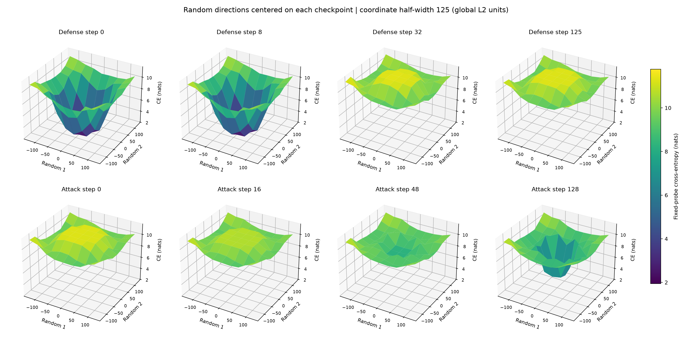
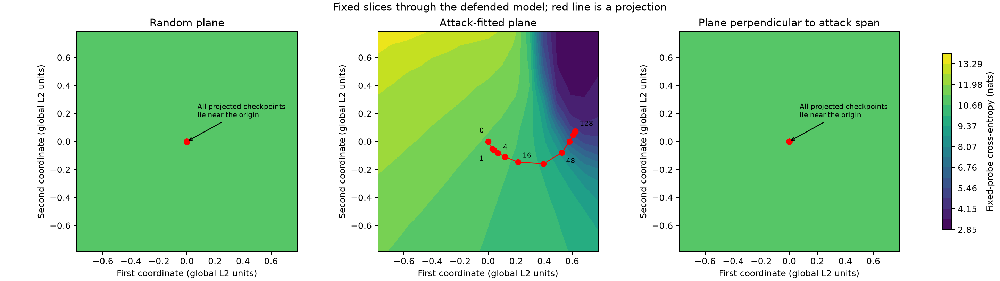

**TAR loss landscapes during defense and attack**

The attacker leaves the original random visualization plane on its first update,
but it does not recover capability immediately. WMDP accuracy stays near the
defended value through step 16, then recovers mainly between steps 32 and 64.
The results support a direction-dependent weakness that the random “fortress”
slice hides. They do not establish a unique wormhole or a discontinuous jump.

This repeats the original 125-step defense with 16 inner attack steps per update
(K16), followed by the collaborator’s 128-step, learning-rate-`1e-6` attack.
The optimization settings follow the [initial reproduction plan](../../../../../../../../TAR_REPRODUCTION_PLAN.md).
The [compute extension](../../../../../../../../TAR_COMPUTE_EXTENSION.md)
and the proposed interventions have not been started.

| Attack step | Distance from defended weights, global L2 | Fixed-probe CE, nats | WMDP accuracy |
|---:|---:|---:|---:|
| 0 | 0.000 | 11.238 | 33.06% |
| 1 | 0.098 | 11.150 | 33.53% |
| 8 | 0.173 | 10.832 | 33.41% |
| 16 | 0.266 | 10.599 | 33.53% |
| 32 | 0.433 | 9.812 | 35.83% |
| 48 | 0.539 | 8.196 | 46.66% |
| 64 | 0.583 | 7.035 | 50.35% |
| 128 | 0.629 | 4.304 | 51.61% |

[Loss, distance, and capability figure](loss-and-capability.png)
· [PDF](loss-and-capability.pdf)
· [All capability scores](capability-scores.csv)
· [Actual checkpoint losses and distances](actual-trajectory.csv).

The broad random views show a valley before defense, a raised plateau by defense
step 32, and a return toward a valley during attack. Each frame uses the same
two random directions, centered on the actual checkpoint. These are parallel
slices of the same fixed loss function. The underlying function has not changed.

[Broad animation](random-landscape-evolution.gif)
· [Broad figure PDF](random-landscape-evolution.pdf).
The coordinate half-width is 125 in every panel. The attack’s total displacement
is only 0.629, so reaching the visible outer wall is not required for recovery.
The random directions are identical to those in the fixed “Random plane” below:
at defense step 125, that smaller window is a 159-fold zoom into this same plane.
The broad sequence shares a vertical and color range of 1.94–11.77 nats.
Earlier radius-125 plots scaled each panel to roughly 9.10–11.44 nats, making
the same plateau relief appear about four times taller.

The three fixed planes below all pass through the defended checkpoint and use
the same coordinate half-width, 0.786. Their directions are orthonormal under
the global L2 norm of the concatenated model parameters.

- **Random:** the collaborator’s seed-42 random directions, orthonormalized.
- **Attack-fitted:** the two dominant directions of the 12 recorded checkpoint
  displacements, with the defended checkpoint as the origin.
- **Perpendicular:** random directions projected perpendicular to the span of
  all 12 recorded displacements, then orthonormalized. Orthogonality is defined
  against the recorded checkpoints, not every unsaved intermediate update.

[Contour PDF](attack-paths.pdf)
· [Three-dimensional surfaces and checkpoint losses](surfaces-and-checkpoints.png)
· [Projection fidelity](projection-fidelity.png)
· [Projection measurements](projection-quality.csv).

Making the random plane explicitly perpendicular barely changes it: their mean
squared subspace overlap is 0.999999997. The original random plane captures less
than `6e-10` of the squared displacement at every recorded attack checkpoint.
Its projected path stays near the origin even while actual loss falls by 6.93
nats. Being inside the plotted coordinate window therefore says little about
whether the actual model lies on the plotted surface. This is expected for a
random plane in a very large parameter space; leaving that plane alone is not
evidence of an unusual escape mechanism.

The attack-fitted plane captures 98.18% of the summed squared checkpoint
displacements. It captures only 36.64% at step 1, versus 99.55% at step 128.
Parameter capture also does not guarantee loss accuracy: projection changes
fixed-probe loss by up to 0.676 nats at step 64. At step 128, projected loss is
4.838 versus actual loss 4.304. Thus the fixed attack-plane surface is a useful
approximation, while the local views centered on actual weights are needed for
faithful checkpoint losses. In the 3D figure, actual losses are deliberately
shown at projected x,y coordinates; those markers can lie off the surface.

[Local animation](local-landscape-evolution.gif)
· [Defense panels](defense-landscape-evolution.png)
· [Attack panels](attack-landscape-evolution.png).
These views keep the attack-fitted directions fixed and move their centers with
the actual weights. Their coordinate half-width is 0.157; loss and color scales
stay fixed across the movie.

The minibatch results argue against recovery being restricted to examples
already used by this attack. All 128 recorded attack batches are distinct.
At step 48, mean loss reduction is 3.02 nats on used batches and 2.88 nats on
future batches. Loss on 32 held-out documents falls from 11.19 to 4.37 nats,
closely tracking the fixed 10-document probe’s 11.24 to 4.30.

[Minibatch dynamics](minibatch-dynamics.png)
shows every observed batch at all 13 attack checkpoints, loss reduction relative
to defense, and each batch’s loss immediately before and after its actual
update. Heatmap rows correspond to the labeled, unevenly spaced checkpoints.
[Fixed individual-batch landscapes](minibatch-landscapes.png) inspect batches
1, 16, 48, and 128 on the defended model’s attack-fitted plane.
[Moving individual-batch views](local-minibatch-landscapes.png) compare the fixed
probe with the next actual batch at model steps 0, 16, and 48, and the last batch
at step 128. These reveal batch-specific contour differences around the same
general descent region. Fixed probes and actual-batch views are complementary.

All surfaces evaluate ordinary causal-language-model cross-entropy (CE) on the
forget corpus, with padding masked and sequences truncated to 512 tokens.
They do not plot TAR’s full defense objective, which includes the inner attack
and retention terms. The fixed probe uses the original first 10 qualifying
documents; the 32 held-out documents exclude all observed attack token
sequences. [Probe metadata](surfaces/probes.json) preserves their hashes.
Directions and projections use FP64 Gram calculations and FP32 stored basis
vectors; model evaluation uses BF16 and eager attention. The previous static
plots used SDPA attention, giving a tiny center-loss difference of about
`5.6e-5` nats. BF16 rounding limits fine-scale interpretation.

The rerun’s defense and all eight shared attack checkpoints exactly match the
original reproduction weights. Their full WMDP and MMLU scores are reused;
steps 1, 2, 4, and 8 received fresh, full evaluations using the same repository
tasks and evaluation protocol. All 867 fixed-grid, 1,296 moving-grid, and 648
broad-grid points are finite. All 27 grid centers exactly match independent
checkpoint measurements. Recomputed observed-batch losses differ from training
measurements by at most 0.006 nats across the different forward layouts.
Three focused tests cover observation hooks, projection geometry, and recovery
of partially saved grids.

[Training validation](training-validation.json)
· [Surface validation](surfaces/validation.json)
· [Center validation](center-validation.json)
· [Batch observation validation](observation-validation.json)
· [Settings, source checksums, and runtime recovery](study.json).

The first surface-analysis attempt stalled and ended during debugger
diagnostics. Completed measurements were preserved; the remaining grids were
recomputed with row-by-row saves and stack traces that do not require debugger
attachment. No training was repeated for this recovery.

This establishes a useful qualitative view: recovery follows directions hidden
by the random fortress slice, with a delayed capability transition rather than
an immediate first-update collapse. The attack-fitted plane is selected after
observing this one attack, and its remaining loss error is material. These
figures cannot establish all vulnerable directions or isolate a causal “secret
passage.” Later comparisons should retain common probes and reference directions,
and always check actual losses alongside projected paths.
